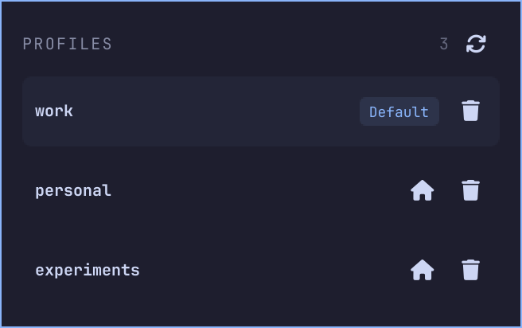
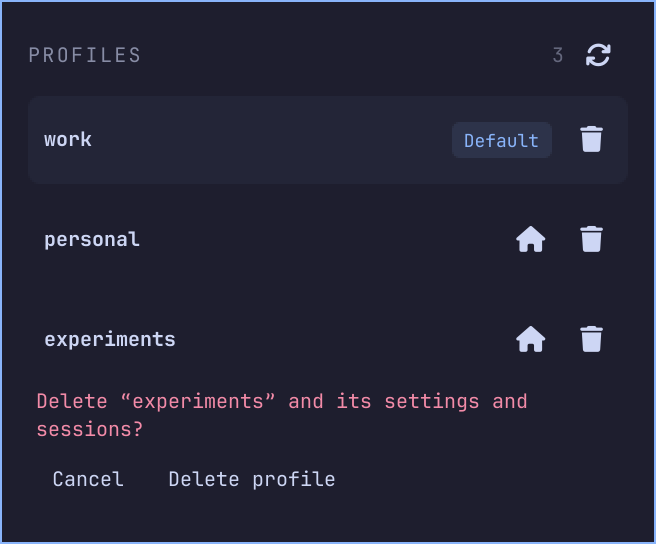

# Pi Profiles for Omarchy

A Quickshell bar plugin for [pi-profiles](https://github.com/chaychoong/pi-profiles).
The bar shows only the official Pi logo. Click to open a compact profile list;
hover to see the default profile.

- Click a profile row to launch it in the configured Omarchy terminal.
- Click the home icon beside a profile to set it as the default.
  A small Default label identifies the current selection.
- Click the trash icon to remove a profile with an inline confirmation. This permanently removes the
  profile directory, including its sessions; removing the default clears it.
- Refresh on opening, every ten seconds, or with a middle click on the bar button.
- Uses Omarchy theme colors, supports scrolling and Escape to dismiss.

Requires Omarchy's Quickshell bar, Python 3, pi, and `ppi` (`npm install -g pi-profiles`).
The plugin uses the installed CLI and honors `PPI_PI_ROOT`. It never reads auth files.
The desktop must have `ppi` on PATH or in the mise shims directory.

## Screenshots

The actual QML menu rendered with example profiles.

| Profile list | Removal confirmation |
| --- | --- |
|  |  |

Regenerate these images with `python3 tools/screenshots.py` on an Omarchy system.
Rendering uses an isolated environment and does not read or modify your profiles.

## Install

Clone and install:

```sh
git clone git@github.com:ianzano/omarchy-pi-profiles.git
cd omarchy-pi-profiles
python3 install.py
```

It installs to
`~/.config/omarchy/plugins/ianzano.pi-profiles/`, backs up the existing bar config,
and adds one bar slot next to the tray. Reinstalling preserves its placement.
Omarchy normally hot-reloads the plugin. If it still displays an older version,
run `omarchy restart shell`.

Run `python3 -m unittest discover -p test_backend.py -v` to test against the installed ppi using temporary
profile directories. Your real profiles are not modified by the tests.
Run `python3 test_ui.py` in your Wayland session for the real Quickshell load
and profile action checks, also using temporary profiles.

To remove the bar widget, run `omarchy plugin disable ianzano.pi-profiles`.

## License

[MIT](LICENSE). The official Pi logo retains its upstream ownership; see [BRANDING.md](BRANDING.md).
